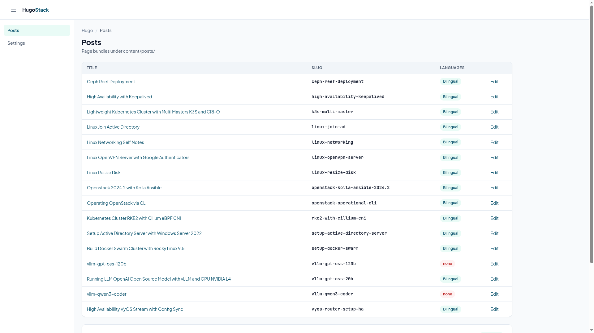
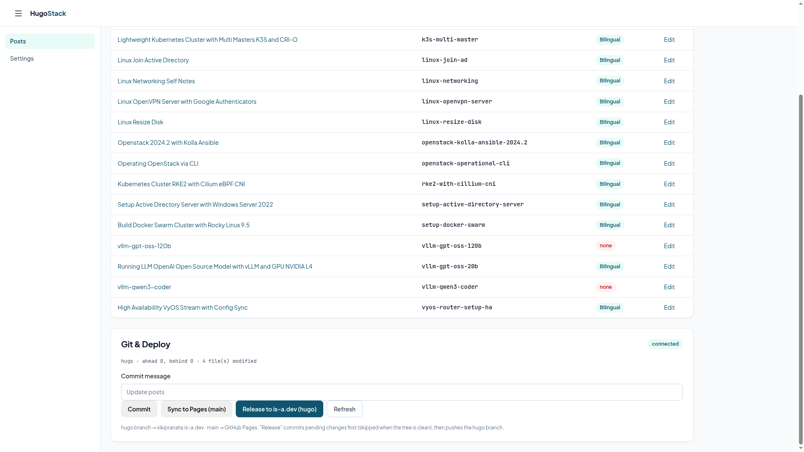
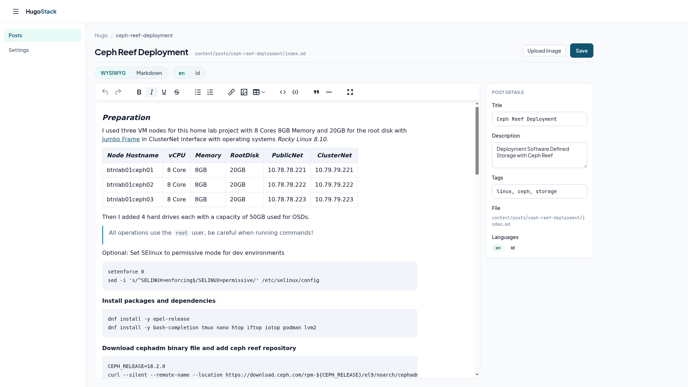
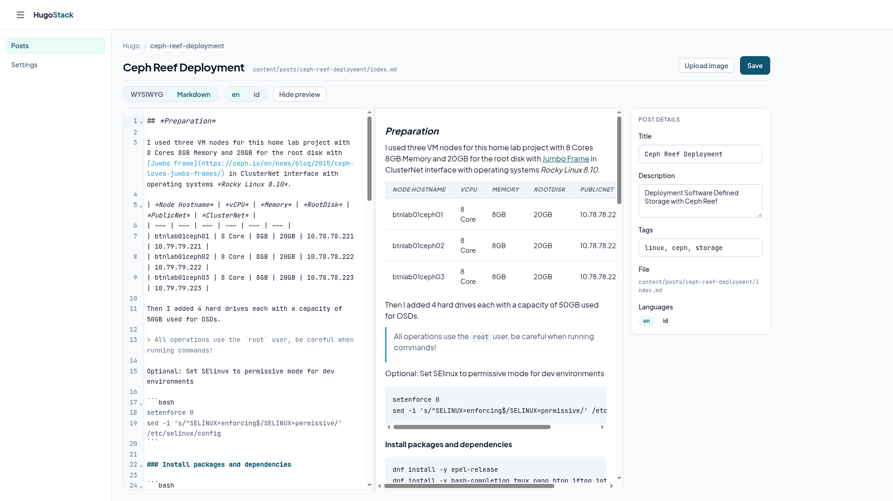
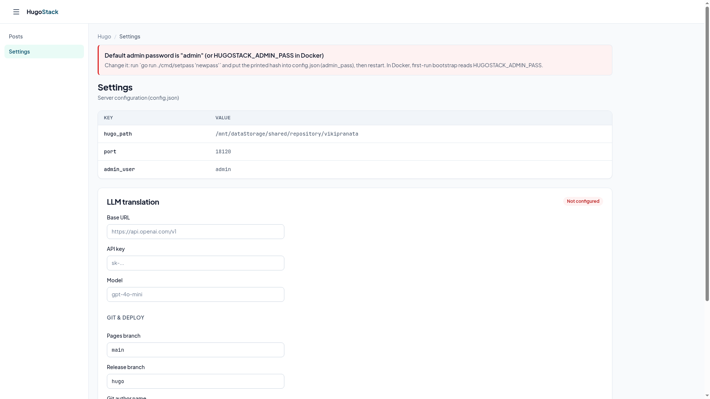

# hugoStack

A single-user content management system for [Hugo](https://gohugo.io/) static sites.
Go backend, zero-build vanilla JS frontend, **no database** — the filesystem is the
source of truth. Edit bilingual posts (EN/ID) in a BookStack-grade editor, upload
images straight into page bundles, translate with any OpenAI-compatible LLM, and
ship through your existing git workflow (GitHub Pages / release branch).

Built for the [vikipranata](https://vikipranata.is-a.dev) site; works with any Hugo
repo that uses `content/posts/<slug>/index.md` page bundles.

## Features

- **BookStack-grade editor**
  - WYSIWYG mode: [TinyMCE 7](https://www.tiny.cloud/) (vendor-bundled, offline)
  - Markdown mode: [CodeMirror 6](https://codemirror.net/) with syntax highlighting,
    live preview pane, draggable divider (20–80%), proportional scroll sync
  - Lossless mode switching — the markdown file is the single source of truth
  - Paste / drop / button image upload in **both** modes
  - `Ctrl/Cmd+S` to save, unsaved-change guard
- **Bilingual workflow** — `index.md` (EN) + `index.id.md` (ID) per post,
  per-language editing, missing-language "new draft" mode
- **LLM translation** — one button, any OpenAI-compatible endpoint; the result
  loads as a *reviewable draft* (never auto-saved). Code blocks, tables, links,
  image paths and `date`/`modified` survive verbatim
- **Frontmatter-safe saves** — only `title` / `tags` / `description` are rewritten,
  line-by-line; everything else (dates, CRLF endings, extra fields) is preserved
  byte-for-byte. Writes are atomic (temp file + rename)
- **Git & Deploy panel** — live branch status (ahead/behind/dirty), commit,
  "Sync to Pages" (`main` → GitHub Pages), "Release" (`hugo` → is-a.dev)
- **Page-bundle uploads** — images land in `content/posts/<slug>/uploads/`,
  referenced with relative paths, so the published site just works
- **Simple auth** — bcrypt password + HttpOnly session cookie. No SSO/IdP
- **Zero DB, zero build steps** — one static Go binary, `config.json` for app
  settings, vendored editor assets (no runtime CDN)

## Screenshots

| | |
|---|---|
|  |  |
| Post list with language status | Git & Deploy panel |

| | |
|---|---|
|  |  |
| WYSIWYG mode (TinyMCE) | Markdown mode (CodeMirror + live preview) |

| |
|---|
|  |
| Settings: LLM + deploy branches |

## Quick start (Docker)

```bash
cp .env.template .env
# fill in: HUGOSTACK_ADMIN_PASS, HUGOSTACK_SESSION_SECRET
docker compose up -d --build
# → http://localhost:8080
```

`docker-compose.yaml` bind-mounts the Hugo repo at `/hugo`. First start
bootstrap-creates `config.json` from the env vars.

**Git push credentials** — pick one:

- Mount the host SSH key: add `- ~/.ssh:/root/.ssh:ro` to `volumes:`
- Or use a token remote: `git remote set-url origin https://<token>@github.com/<user>/<repo>.git`

Without either, *Sync to Pages* / *Release* fail with git's SSH error shown
verbatim in the deploy panel.

## Quick start (native)

Requires Go ≥ 1.27.

```bash
# 1. config (or let it fail and edit config.json)
cat > config.json <<EOF
{
  "hugo_path": "/path/to/your/hugo-repo",
  "port": 8080,
  "admin_user": "admin",
  "admin_pass": "<bcrypt-hash>"
}
EOF

# 2. generate the bcrypt hash
go run ./cmd/setpass 'yourpassword'
# paste the printed hash into config.json

# 3. run
go run ./cmd/server
```

The binary reads `ui/templates` and `ui/static` from its working directory, so
run it from the repo root (or keep `ui/` next to the binary).

## Configuration

`config.json` (path overridable via `HUGOSTACK_CONFIG`):

| Key | Meaning |
|---|---|
| `hugo_path` | Absolute path to the Hugo repository root |
| `port` | HTTP listen port |
| `admin_user` / `admin_pass` | Login; `admin_pass` is a bcrypt hash |
| `llm_base_url` / `llm_api_key` / `llm_model` | OpenAI-compatible LLM for translation (all three required for the Translate button to appear) |
| `branch_pages` / `branch_release` | Push targets (defaults `main` / `hugo`) |
| `git_user` / `git_email` | Commit identity (defaults `hugoStack` / `hugostack@localhost`) |

Edit via the **Settings** page (LLM + git fields) or directly in the file
(server config keys like `hugo_path`/`port` are file-only). Settings-page
changes persist to `config.json` and take effect in the running process
immediately. Direct edits to `config.json` are picked up on next start (the
process caches config at load); `port` and `hugo_path` always require a
restart to take effect.

Environment variables (Docker bootstrap, read once at first start):

| Variable | Purpose |
|---|---|
| `HUGOSTACK_CONFIG` | config.json path (default: CWD in native, `/app/config.json` in Docker) |
| `HUGOSTACK_PORT` | Listen port — overrides `config.json` at start (default 8080) |
| `HUGOSTACK_ADMIN_PASS` | First-run bootstrap: bcrypt-hashed into a fresh config.json |
| `HUGOSTACK_SESSION_SECRET` | Session cookie secret; without it logins drop on restart |
| `HUGOSTACK_GIT_USER` / `HUGOSTACK_GIT_EMAIL` | Commit identity — override config.json at start |
| `HUGOSTACK_HUGO_PATH` | Hugo repo path — overrides `config.json` at start (default `/hugo` in Docker) |

Env vars win over the config file at startup (`applyEnv` in
`internal/config`), which keeps the Docker setup durable even though
`/app/config.json` is ephemeral inside the container.

## Daily workflow

1. Open a post, edit in WYSIWYG or Markdown, paste screenshots
2. **Save** — the `.md` file is rewritten in place (frontmatter-safe)
3. Translate → review the draft → Save (creates/updates the other-language file)
4. In the **Git & Deploy** panel: *Commit* → *Sync to Pages* (GitHub Pages)
   and/or *Release* (pushes the release branch to the is-a.dev pipeline)

## Project layout

```
cmd/server/         HTTP server, routes, handlers
cmd/setpass/        bcrypt hash helper for config.json
internal/auth/      bcrypt check + session token
internal/browser/   post scanner, frontmatter split/rewrite (line-by-line)
internal/config/    JSON config load/save (RWMutex)
internal/git/       system-git wrapper (status/commit/push, ref validation)
internal/llm/       OpenAI-compatible chat client
ui/templates/       html/server templates (shell, index, editor, settings, login)
ui/static/app/      editor.js (mode switching, uploads, save, translate)
ui/static/vendor/   TinyMCE 7, CodeMirror 6 bundle, turndown, marked (offline)
docs/               technical documentation + screenshots
_bmad/              planning docs (initiative / architecture / backlog)
```

## Development

```bash
go build ./...
go vet ./...
go test ./...
go run ./cmd/server   # dev server on the port from config.json
```

## Documentation

- [Technical reference](docs/technical.md) — architecture, data model, full HTTP
  API, security, vendor notes, troubleshooting
- `_bmad/docs/` — original planning docs (initiative, architecture intent, backlog)

## License

[GNU GPL v3](LICENSE)
